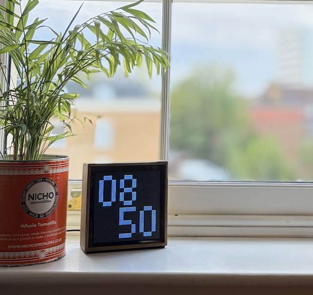

# matrix-display-manifest

A collection of utilities, scripts, and reference assets from my tinkering with [MicroPython](https://micropython.org/), the [Interstate 75 W](https://shop.pimoroni.com/products/interstate-75-w) driver board (built around the [Raspberry Pi Pico W](https://www.raspberrypi.com/products/raspberry-pi-pico/)), and a 64x64 LED matrix display.

## Manifest Schema

[ [View: Schema](./display-manifest.schema.json) ] [View: Examples](./examples/)

The Matrix Display Manifest is a lightweight JSON schema for declaratively rendering graphics on an LED matrix display. It lets me "program" the display remotely over the network, at a small cost to performance.

### Why a Manifest?

The alternatives I considered:

1. **Custom rendering logic and network calls on the driver board.**\
   Updates require a manual USB code flash, which makes iteration slow.

2. **Server-rendered PNG buffers sent over the network.**\
   This works, but it complicates the server code. I also found image libraries such as [Sharp](https://sharp.pixelplumbing.com/) had limited support on [FaaS](https://en.wikipedia.org/wiki/Function_as_a_service) platforms such as [Cloudflare Workers](https://workers.cloudflare.com/).

### Drawing Types

The schema supports three drawing types:

- **`text`**\
  Renders a text string using the client's text-rendering methods. In the case of the Interstate 75 W board that is the [PicoGraphics](https://github.com/pimoroni/pimoroni-pico/tree/main/micropython/modules/picographics) library which is bundled in the default ROM.

- **`block`**\
  Renders a flat, row-major array of palette indices wrapped at a set width to represent a 2D sprite. `0` leaves a cell transparent, while positive integers select colors from the optional `palette` object. The optional `color` is used for indices without a palette entry, and keeps simple binary (`0`/`1`) blocks compact.

- **`rect`**\
  Renders a rectangle or a straight horizontal/vertical line. It can also be used to fill or reset the background color. More complex polygons can be constructed with a `block` drawing.

## Demos & Example Scripts

### Manifests

[ [View: Examples](./examples/) ]

Several static (`static-*.jsonc`) JSON manifests demonstrate the `rect`, `text`, and `block` drawing types, as well as the supported temporal configurations.

The [Node-RED](https://nodered.org/) flows (`nodered-*.json`) demonstrate how to generate a manifest dynamically. I run Node-RED on a home server which serves manifests over my local network. It has a browser-based visual editor which makes iteration fast. Each flow responds to a network request with the JSON response prepared in a JavaScript module.

### Client Script

[ [View: Client Script (MicroPython)](./interstate75w/main.py) ]

> [!NOTE]
> I'm not a MicroPython expert, and this code was heavily LLM-assisted.

A MicroPython script which periodically fetches a manifest and renders it on my hardware configuration of an Interstate 75 W board and 64x64 LED matrix display.

### Sprite-Like Assets

[ [View: Sprite-Like Assets](./assets/) ]

- A JSON file of digit sprites for use with the `block` drawing type. Each key is a digit (`"0"` to `"9"`) and each value is a flat array of `0`/`1` values, wrapped at a line length of 5 to form a 5x7 grid.

## License

Released under the [MIT License](LICENSE).
